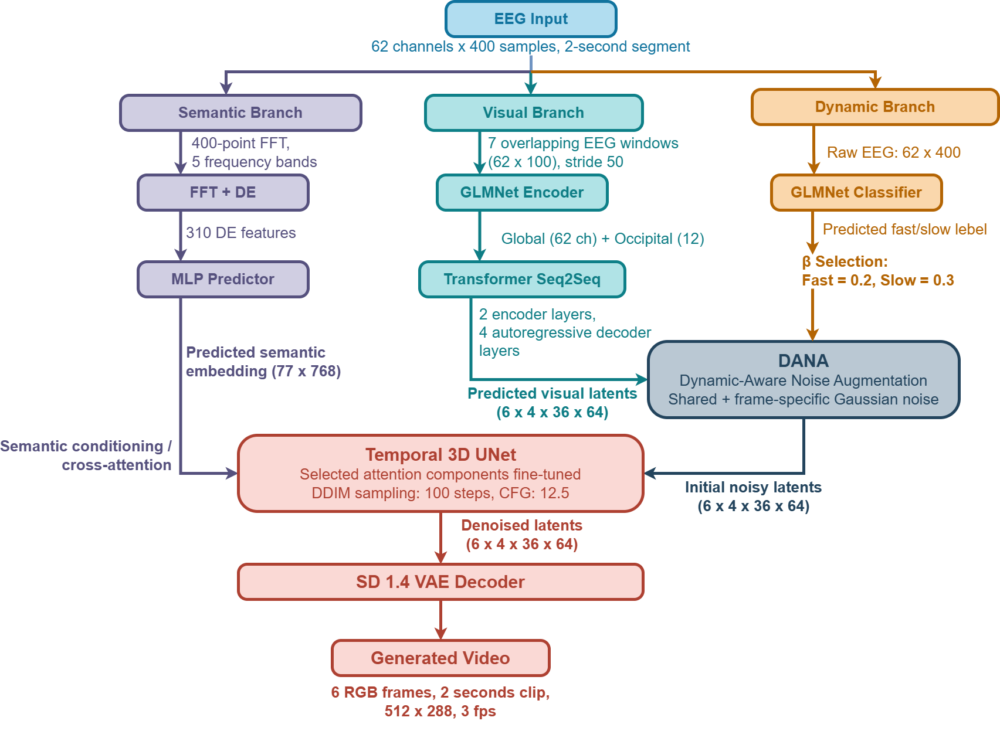
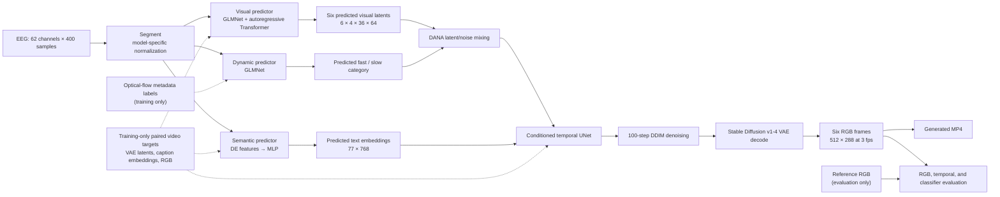
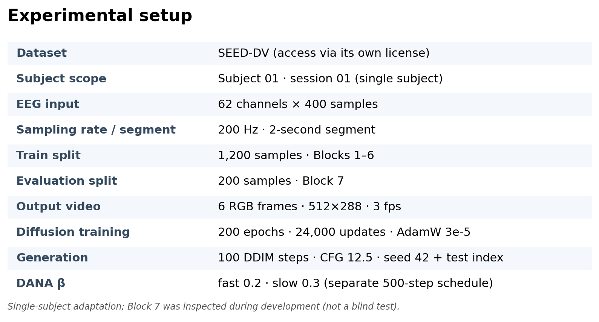
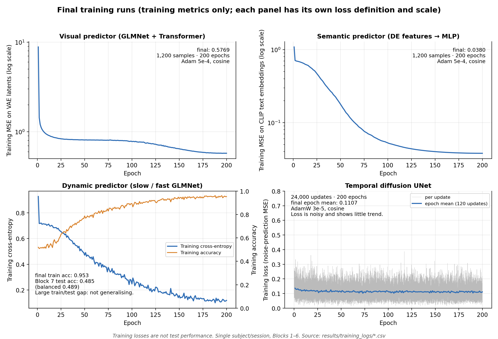
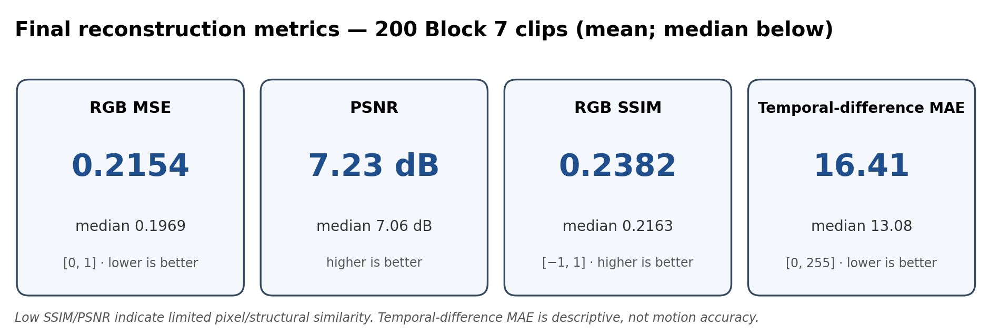
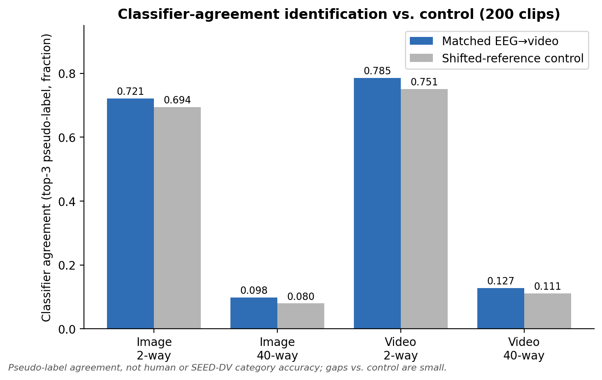
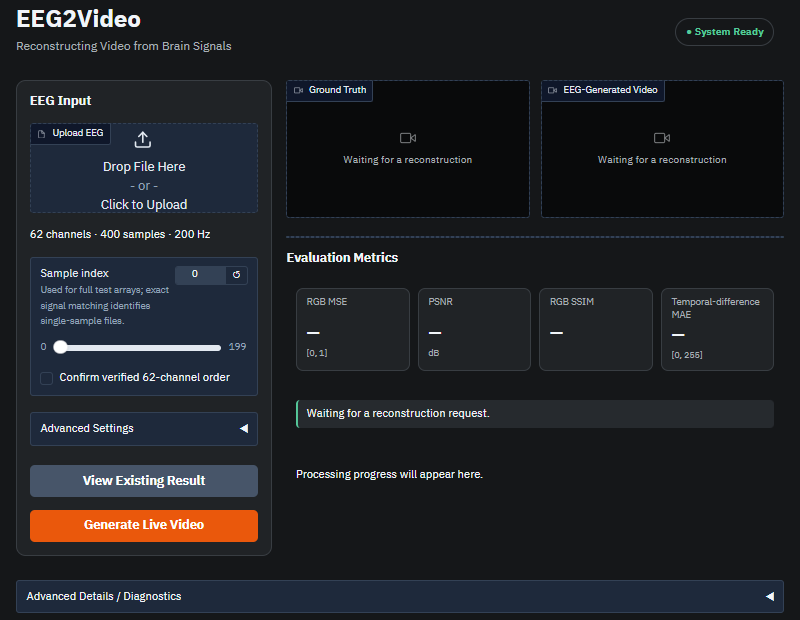

# EEG2Video: Reconstructing Visual Experiences from Brain Signals

*A single-subject implementation using deep learning and video diffusion models*

This capstone implements and evaluates an end-to-end pipeline that maps EEG recordings to short generated videos. It combines three EEG prediction branches with a temporally conditioned diffusion model, evaluates 200 held-out-by-block samples, and provides a functional local Gradio application.

> **Scope:** this is a single-subject/session adaptation inspired by the EEG2Video research framework—not an exact reproduction of the multi-subject paper. The final Block 7 was inspected during development, so it is not a pristine blind test. Data, trained weights, prediction arrays, and generated/reference media are external; cloning this source release does not provide them.

## Project overview

EEG measures brain activity non-invasively, but the signal is noisy and has limited spatial resolution. Inferring the content and temporal evolution of a viewed video from EEG is therefore a difficult research problem. This project implements three complementary predictors—visual, semantic, and dynamic—and conditions a temporal video-diffusion pipeline on their outputs.

The completed work covers data preparation, predictor training, temporal UNet fine-tuning, six-frame video generation, quantitative evaluation, classifier-based identification controls, and a local demonstration app. The experimental scope is one participant/session from SEED-DV: 1,200 samples from Blocks 1–6 for training and 200 samples from Block 7 for evaluation.

### Objectives

- Implement EEG segmentation and reproducible sample-to-video pairing.
- Predict visual latents, caption embeddings, and fast/slow dynamics from EEG.
- Fine-tune and run a temporal diffusion model conditioned by those predictions.
- Evaluate all 200 Block 7 outputs and preserve the run configuration and evidence.
- Deliver a local interface for retrieving a completed example or running a new single-sample inference.

These objectives are inferred from the completed implementation and reports. The release evidence does not establish sponsor-specific requirements.

## System architecture

The diagram distinguishes training targets from inference inputs. Ground-truth video is used for training targets and is only compared with generated output during evaluation; it is not an inference condition.

<p align="center"></p>

*Figure 1. EEG2Video inference pipeline. The reference video is used only for evaluation. A text version of the same flow follows.*



The runtime implementation and its adaptations are described in [Methods and deviations](docs/METHODS_AND_DEVIATIONS.md). Artifact requirements and the app's local-only asset resolver are in [External assets setup](docs/EXTERNAL_ASSETS_SETUP.md).

## Methodology

1. **Dataset preparation:** one participant/session is split by block: Blocks 1–6 (1,200 EEG/video pairs) for training and Block 7 (200 pairs) for evaluation.
2. **EEG preprocessing:** each two-second segment contains 62 channels and 400 samples at 200 Hz. The preprocessing path does not add filtering or resampling. Video pairing samples six RGB frames at nominal 24 fps and resizes them to 512×288; source videos report 23.976 fps, so exact physiological synchronization is not established.
3. **Visual prediction:** seven overlapping 100-sample EEG windows (50-sample stride) are encoded by global and occipital-local GLMNet branches. An autoregressive Transformer predicts six VAE latents, each with shape 4×36×64.
4. **Semantic prediction:** the selected full-window 400-point FFT variant produces 310 differential-entropy (DE) features from the band-power calculation. An MLP predicts 77×768 CLIP text embeddings. No additional feature standardization occurs during feature extraction; the predictor fits normalization on training features.
5. **Dynamic prediction:** a two-branch GLMNet predicts slow/fast dynamics from raw two-second EEG. Labels use the documented optical-flow-score threshold 1.799 (0=slow, 1=fast).
6. **Video diffusion:** a temporally conditioned UNet is fine-tuned on training video latents and caption embeddings. Only the configured attention projections are trained. At generation, predicted visual latents are mixed with DANA noise; the dynamic prediction selects fast β=0.2 or slow β=0.3, using a separate 500-step linear noise schedule, while semantic embeddings condition the UNet. DDIM then denoises and the Stable Diffusion VAE decodes RGB frames.
7. **Evaluation:** generated frames are compared with reference frames after generation. RGB and temporal metrics are reported separately from the ViT/VideoMAE classifier-agreement experiment.

This implementation includes material adaptations from the paper and released code. In particular, the GLMNet–Seq2Seq model is a reconstructed integration rather than an upstream released checkpoint; the semantic predictor uses the full-window 400-point feature variant; and the DANA schedule, beta mapping, and decoding choices are documented adaptations. See [Methods and deviations](docs/METHODS_AND_DEVIATIONS.md) and [the upstream provenance note](EEG2Video/EEG2Video_New/Generation/SOURCES.md).

## Experimental setup

| Item | Verified configuration |
|---|---|
| Dataset subset | SEED-DV, subject 01 / session 01 |
| EEG input | 62 channels × 400 samples; 200 Hz; 2 seconds |
| Split | 1,200 samples from Blocks 1–6 for training; 200 samples from Block 7 for evaluation |
| Video targets | Six RGB frames, 512×288, 3 fps; sampled at offsets 0, 8, 16, 24, 32, and 40 from nominal 24 fps |
| Visual latent prediction | Six latents of shape 4×36×64 per sample |
| Semantic prediction | 77×768 embedding per sample |
| Dynamic prediction | Two classes: slow and fast |
| Final generation | 100 DDIM steps; classifier-free guidance scale 12.5; DANA timestep sampled separately from 0–499; seed 42 + test index |
| Completed final evaluation | 200/200 Block 7 outputs; all completion records present |

<p align="center"></p>

*Figure 2. Experimental setup summary (values from the table above).*

These are the settings recorded for this single-subject implementation, not a population-wide experiment. The full dataset has more subjects; this repository's experiment does not use all of them.

## Model training

| Model | Purpose and architecture | Final training configuration | Recorded outcome (final-epoch **training** metrics unless labelled Block 7) |
|---|---|---|---|
| Visual predictor | Global/local GLMNet branches plus Transformer encoder/decoder; predicts six VAE latents | 1,200 samples; 200 epochs; Adam, 0.0005 learning rate, cosine schedule; effective batch 32 with micro-batch 4 | Final training MSE 0.5769 (200 epochs); produces `(200, 6, 4, 36, 64)` Block 7 predictions. No held-out loss was recorded. |
| Semantic predictor | MLP: 310 inputs, four 10,000-unit hidden layers, 59,136 outputs (77×768) | Full-window 400-point FFT features; 1,200 samples; 200 epochs; Adam, 0.0005 learning rate, cosine schedule; batch 32 | Final training MSE 0.0380. This is a training loss, not an evaluation or video-quality metric. |
| Dynamic predictor | Two-branch GLMNet; 256 features per branch; binary slow/fast output | Raw two-second EEG; 1,200 samples; 200 epochs; Adam, 0.0005 learning rate, cosine schedule; batch 8 | Block 7 test accuracy 0.485 and balanced accuracy 0.4895 (held-out metrics, not training metrics); for a two-class task this is at or below the 0.5 chance level, so the dynamic predictor shows no demonstrated predictive skill. Training accuracy 0.9533 (final training cross-entropy 0.1195) reflects fitting of the 1,200 training samples only. |
| Temporal diffusion UNet | Fine-tuned attention projections (`attn1.to_q`, `attn2.to_q`, `attn_temp`), conditioned on CLIP embeddings | 1,200 training clips; 200 epochs; 24,000 updates; AdamW, initial learning rate 0.00003 with cosine schedule; effective batch 10, micro-batch 1 | Recorded run completed all 24,000 updates; Block 7 was not used for diffusion training. Final-epoch mean training loss 0.1107; the per-step loss is noisy and nearly flat. No held-out loss was recorded. |

<p align="center"></p>

*Figure 3. Training records of the final runs, from [`results/training_logs/`](results/training_logs/). Panels use different loss definitions and scales and are not comparable with each other.*

Training losses and test metrics answer different questions. A completed run or decreasing training loss does not establish faithful video reconstruction. The checkpoints and some training inputs are not included; see [External artifacts](docs/EXTERNAL_ARTIFACTS.md).

## Experimental results

### Quantitative reconstruction

The table reports mean results across all 200 Block 7 samples. No best-of-many outputs were selected: the final run used one fixed seed per clip.

| Metric | Mean | Scale and interpretation |
|---|---:|---|
| RGB MSE | 0.2154 | RGB values normalized to [0, 1]; lower is closer pixel-wise |
| PSNR | 7.2349 dB | Computed from pooled RGB MSE over the six frames |
| RGB SSIM | 0.2382 | Framewise SSIM, uint8 RGB, data range 255, uniform 7×7 window; mean over six frames |
| Temporal-difference MAE | 16.4065 / 255 | Absolute error between signed adjacent-frame RGB changes; descriptive only, **not motion accuracy** |

<p align="center"></p>

*Figure 4. Mean reconstruction metrics over 200 Block 7 clips, each shown on its own scale.*

The low SSIM and PSNR indicate limited pixel/structural similarity. These metrics do not establish whether a person can recognize the scene or whether its motion is correct. The full definitions and per-clip values are in [`results/final_generation/summary.json`](results/final_generation/summary.json) and [`results/final_generation/per_clip_metrics.csv`](results/final_generation/per_clip_metrics.csv).

### Classifier-based identification and controls

The separate identification experiment measures whether pretrained classifiers rank any of the top-three labels inferred from a reference above sampled distractors. Results are means over 200 clips and 100 trials per clip.

| Classifier | N-way | Matched reference | Shifted-reference control | Difference |
|---|---:|---:|---:|---:|
| ViT image | 2 | 0.7213 | 0.6941 | +0.0272 |
| ViT image | 40 | 0.0984 | 0.0795 | +0.0189 |
| VideoMAE | 2 | 0.7855 | 0.7514 | +0.0342 |
| VideoMAE | 40 | 0.1275 | 0.1107 | +0.0168 |

<p align="center"></p>

*Figure 5. Matched vs shifted-reference identification scores. Differences are small.*

These are **classifier pseudo-label agreement scores**, not human recognition accuracy and not accuracy on the 40 SEED-DV concepts. N-way distractors are sampled from the classifiers' 1,000-class ViT and 400-class VideoMAE label spaces. The accepted reference set contains three labels, so conventional chance baselines do not apply. The shifted control pairs each generated clip with a reference five positions away; it is an empirical control, not a formal permutation significance test. Matched scores are only modestly above the shifted controls and do not establish faithful geometry or motion. See the [identification protocol](docs/IDENTIFICATION_PROTOCOL.md) and [full summary](results/identification/summary.json).

### Qualitative results

The five candidate samples were fixed at test indices 0, 50, 100, 150, and 199 before media selection; they were not selected by metric score. Their comparison images include dataset-derived reference frames and are not cleared for redistribution.

<!-- TODO: Add one approved ground-truth/generated comparison to docs/media/ after SEED-DV and derived-media redistribution permission is verified. Do not link to private or unapproved media. -->

## Interactive local application

The [Gradio application](webapp/README.md) runs locally and binds to `127.0.0.1`. It is not hosted by GitHub Pages and there is no public demo URL.

- **Precomputed reconstruction:** upload an EEG sample that exactly matches a known Block 7 signal to retrieve the stored generated/reference videos and verified historical metrics. No predictors or diffusion are run.
- **Live EEG inference:** runs the three saved predictors and a new 100-step diffusion generation for a single valid sample. For an unmatched sample, it shows no reference video or historical metrics.

Both modes support an authorized non-pickled `.npy` upload with shape `(62, 400)`, `(1, 62, 400)`, or the exact canonical array `(200, 62, 400)`. Input must be 200 Hz and use the recorded channel order; the app does not reshape or resample. The interface displays stage progress, elapsed time, and an estimated remaining time after progress is available. It can show evaluation metrics and provide an MP4 download.

The application has been exercised in the documented local Windows setup, including a one-sample live inference. A clean-machine installation and other platforms/GPUs are not verified. See [environment notes](docs/ENVIRONMENTS.md) before setup.

<p align="center"></p>

*Figure 6. Local Gradio interface (idle state; no reconstruction displayed).*

## Repository structure

```text
.
├── EEG_preprocessing/                  # Segmentation, pairing, features, training targets
├── EEG2Video/EEG2Video_New/
│   ├── Seq2Seq/                         # Visual GLMNet + Transformer
│   ├── Semantic/                       # Semantic MLP
│   ├── Dynamic/                         # Dynamic classifier
│   ├── Generation/                     # Temporal UNet training and vendor code
│   ├── FinalEvaluation/                 # Final generation and RGB metrics
│   └── IdentificationEvaluation/         # Classifier-agreement evaluation
├── results/                             # Compact summaries, metrics, and provenance
├── webapp/                              # Local Gradio app, worker, tests, requirements
├── data/                                # Dataset access and input notes; no data
└── docs/                                # Methods, environment, assets, audit, and evidence
```

Checkpoints, raw EEG, dataset-derived arrays/media, and local cache files are deliberately excluded.

## Installation and running the web application

The validated configuration uses separate Python 3.11 environments: one for the Gradio UI and another for inference. The tested host was Windows 11 / Python 3.11.16. The UI used Gradio 5.50.0 and NumPy 2.4.6. The worker used PyTorch 2.2.2+cu118, CUDA 11.8, Diffusers 0.11.1, Transformers 4.26.1, xFormers 0.0.25.post1+cu118, and the pins in `webapp/worker-requirements.txt`. Other systems and GPU combinations are not verified.

Create the UI environment from the repository root:

```powershell
py -3.11 -m venv webapp\.venv
.\webapp\.venv\Scripts\python.exe -m pip install -r webapp\requirements.txt
```

Create a separate worker environment. Install CUDA-compatible PyTorch and xFormers for the target driver/GPU first, then install `webapp/worker-requirements.txt`. These requirements do not select a CUDA wheel. Do not install the webapp pins over a working training environment. Research and training requirements are preserved separately and are not a single tested environment; see [`docs/ENVIRONMENTS.md`](docs/ENVIRONMENTS.md).

After you have authorized access to the external files described in [External assets setup](docs/EXTERNAL_ASSETS_SETUP.md), set the two required variables and start the checked launcher:

```powershell
$env:EEG2VIDEO_ASSETS_DIR = "<authorized-assets-root>"
$env:EEG2VIDEO_WORKER_PYTHON = "<worker-environment>\python.exe"
.\run_webapp.bat
```

Open `http://127.0.0.1:7860`. The launcher installs no packages and downloads no models. The app requires `asset_config.json` under the asset root (or an explicit `EEG2VIDEO_ASSET_CONFIG`); all configured asset paths are relative to that root. The optional `EEG2VIDEO_CACHE_DIR` changes the local upload/output cache.

## External data and model assets

The public source release does **not** contain the complete dataset, trained checkpoints, predictor arrays, generated videos, negative-conditioning embedding, or all base-model components. Access to private artifacts is restricted and may require authorization. Cloning the repository does not grant access.

- Precomputed mode requires canonical test EEG, channel metadata, mappings, reference RGB arrays, generated RGB arrays, completion records, and metrics.
- Live inference additionally requires the three predictor checkpoints and normalizers, their Block 7 predictions/mappings, the temporal UNet and scheduler/provenance, the verified negative embedding, and the local Stable Diffusion v1-4 VAE.
- Full retraining requires additional authorized EEG/video inputs, annotations, targets, training state, and compatible model/environment components.

`asset_config.json` uses portable relative paths. `asset_manifest.json` is generated for local provenance/hash checking; it is not a runtime download mechanism and may contain local source paths, so keep it private. See [External assets setup](docs/EXTERNAL_ASSETS_SETUP.md), [artifact details](docs/EXTERNAL_ARTIFACTS.md), and the [private storage assessment](docs/PRIVATE_ASSET_STORAGE_PLAN.md).

## Reproducibility

- **Inspecting preserved results:** the release includes compact summaries, per-clip metrics, run configurations, and provenance for the completed 200-sample evaluation.
- **Running authorized inference:** the local app and asset resolver were tested with the documented Windows environment and private assets. This does not guarantee a clean install or cross-platform execution.
- **Retraining:** training source and run summaries are present, but the required data, targets, checkpoints, and some external model artifacts are not. Research dependency files conflict across Diffusers/Transformers versions; the diffusion-training and final-generation CLIs retain legacy development-root defaults and require an explicit root.
- **Reproducing the full research study:** not supported by this single-subject project. It does not reproduce the original multi-subject evaluation or establish equivalent results.

The final Block 7 was previously inspected during diagnostics. Results should not be described as a blind test. More detail is in the [publication audit](docs/GITHUB_PUBLICATION_AUDIT.md).

## Limitations

- One subject/session and a previously inspected Block 7; no evidence of cross-subject or population generalization.
- Pixel and structural reconstruction quality is limited; semantic classifier agreement only modestly exceeds the shifted-reference control.
- Six frames at 3 fps and approximate nominal video timing do not establish accurate motion or physiological synchronization.
- No human recognition study was conducted. Temporal-difference MAE is not motion accuracy.
- The research environment is not a unified, clean-checkout installation; inference requires CUDA-capable hardware and restricted external assets.
- Some checkpoint, dataset, model, and media redistribution permissions remain unresolved.

This work demonstrates a completed engineering and evaluation pipeline, not reliable reconstruction of arbitrary visual experiences.

## Future work

Potential next steps: not completed features—include multi-subject evaluation, stronger semantic alignment, improved temporal consistency, additional validation with a truly unseen test protocol, and deployment only after artifact rights, access controls, and resource requirements are resolved.

## Research references

1. Xuan-Hao Liu, Yan-Kai Liu, Yansen Wang, Kan Ren, Hanwen Shi, Zilong Wang, Dongsheng Li, Bao-Liang Lu, and Wei-Long Zheng. “EEG2Video: Towards Decoding Dynamic Visual Perception from EEG Signals.” NeurIPS 2024. [Proceedings page](https://papers.nips.cc/paper_files/paper/2024/hash/84bad835faaf48f24d990072bb5b80ee-Abstract-Conference.html) · [PDF](https://papers.nips.cc/paper/2024/file/84bad835faaf48f24d990072bb5b80ee-Paper-Conference.pdf).
2. XuanhaoLiu et al. [Official EEG2Video repository](https://github.com/XuanhaoLiu/EEG2Video), reference commit [`18af805`](https://github.com/XuanhaoLiu/EEG2Video/tree/18af805753bc89e796625cdaaca1d0844bee22a8). The capstone adapts and extends selected components; it is not the original authors' release.
3. Robin Rombach et al. “High-Resolution Image Synthesis With Latent Diffusion Models.” CVPR 2022. [Paper](https://arxiv.org/abs/2112.10752) · [Stable Diffusion v1-4 model card and terms](https://huggingface.co/CompVis/stable-diffusion-v1-4).
4. Zhan Tong, Yibing Song, Jue Wang, and Limin Wang. “VideoMAE: Masked Autoencoders are Data-Efficient Learners for Self-Supervised Video Pre-Training.” 2022. [arXiv](https://arxiv.org/abs/2203.12602) · [Kinetics-400 checkpoint card](https://huggingface.co/MCG-NJU/videomae-base-finetuned-kinetics).

## Contributors and acknowledgements


| Role | Name / details |
|---|---|
| Capstone team members | `Animesh Das Chowdhury, Rayan Hossain Khan, MD Golam Mohiuddin Labib, Nasrin Jahan` |
| Sponsor | `Dr. Min Wang` |
| Academic Mentor | `Mathew Vestal` |
| Institution / programme / year | `[TO BE COMPLETED BY PROJECT OWNER]` |

The EEG2Video method, the SEED-DV dataset, and the upstream code are the work of their respective authors (see the references above and [third-party attribution](docs/THIRD_PARTY_ATTRIBUTION.md)). Those researchers are not members of this capstone team and have not endorsed this project.

## License and usage

No project license is included. Do not assume that the repository's code, models, dataset, or generated/reference media may be redistributed or used without restriction. The upstream EEG2Video source and its Diffusers-derived vendor files require attribution and license review; the Stable Diffusion v1-4 model card identifies CreativeML OpenRAIL-M terms; the VideoMAE checkpoint card states CC-BY-NC-4.0. SEED-DV access requires its own license/application process. Review each applicable term before distribution or use. See the [third-party attribution](docs/THIRD_PARTY_ATTRIBUTION.md) and [publication blockers](docs/PUBLICATION_BLOCKERS.md), and the [publication audit](docs/GITHUB_PUBLICATION_AUDIT.md).
